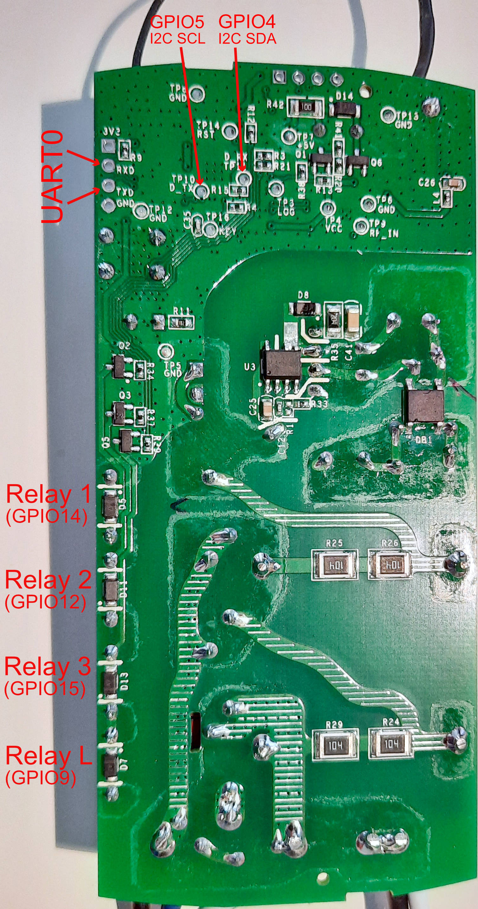
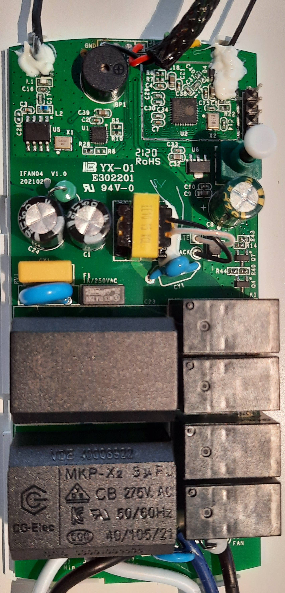
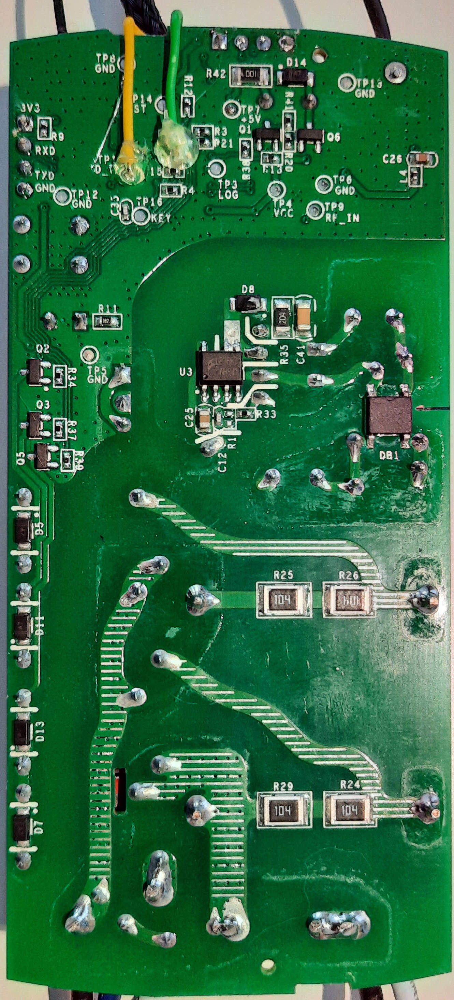

# esphome-ifan04

ESPHome package set for the Sonoff iFan04 and iFan03 fan controllers.

> [!NOTE]
> Reusable ESPHome package and template set for Sonoff iFan04 and iFan03 devices, including RF remote handling, Home Assistant events, optional startup boost, and optional advanced buzzer features.

This repository provides reusable ESPHome package files for the iFan hardware-specific logic and template files that can be used as ready-to-adapt starter configurations. The goal is to keep the iFan04-specific behavior in shared package files so it can be reused without duplicating the full device configuration in every user project.

Based on the currently known hardware, the iFan04 and iFan03 use the same GPIO assignments. The PCB layout differs, but the ESPHome configuration should work on both models.

Release history and dated change notes are tracked in [RELEASE_NOTES.md](RELEASE_NOTES.md).

## ✨ Project overview

The ESPHome packages in this repository provide:

- fan control for the relay and capacitor combinations used by the iFan
- light control for the built-in light relay
- RF remote control decoding via UART0 using the external `ifan_remote` component
- forwarding decoded remote-control commands to Home Assistant as events
- optional buzzer feedback for remote button presses
- optional startup boost for fans that need a high-speed kick on start
- optional advanced buzzer support with Morse-code output and a Home Assistant action

The package files contain the iFan-specific logic. The template files add the common device settings around those packages, such as Wi-Fi, API, OTA, web server, diagnostics, and example extension points.

## 🚀 How to use

You can use this repository in two ways:

1. Start from one of the template files in this repository and adapt the substitutions and secrets for your device.
2. Import one of the package files directly into your own ESPHome configuration.

> [!TIP]
> Start with a template file if you want a ready-to-adapt configuration. Import a package directly if you already have an ESPHome base config and only want the iFan-specific logic.

### 📦 Direct package import

Use the package that matches the behavior you want:

```yaml
packages:
  ifan04:
    url: https://github.com/rh1rich/esphome-ifan04
    files:
      - main.yaml
```

Your own configuration then provides the usual device-specific sections such as `esphome`, `api`, `ota`, and `wifi`.

### 🧩 Template-based setup

If you prefer a ready-made starting point, copy one of the template files and adjust:

- substitutions such as `devicename` and `friendly_devicename`
- secrets for Wi-Fi, API encryption, OTA password, and fallback AP
- optional API actions, I2C, or sensors depending on the selected template

## 📦 Package files

### ⚙️ `main.yaml`

The default iFan package.

It provides:

- standard light control
- standard fan control for the usual iFan relay mapping
- startup boost support controlled through `fan_startup_boost_time`
- RF remote command handling
- simple buzzer feedback only when a remote-control button is pressed
- configuration switches for buzzer enable, light enable, and startup boost enable

Use this package when you want the normal iFan behavior with a compact feature set.

### 🔔 `main_adv_buzzer.yaml`

The advanced buzzer package.

It builds on the standard setup and adds:

- the external `morse_code` component
- configurable Morse-style buzzer patterns via substitutions
- different buzzer patterns for light, mute, fan-speed, pairing, and unpairing actions
- support for a Home Assistant API action that plays custom Morse-code text through the buzzer

Use this package if you want richer audible feedback or want to trigger buzzer signaling from Home Assistant.

### 🌀 `main_4_speeds.yaml`

The alternate 4-fan-speed package.

It changes the fan relay mapping so the controller can use four hardware speed states:

- low: relay 1
- mid 1: relay 2
- mid 2: relay 1 + relay 2
- high: relay 3

Use this package if your capacitor setup supports four distinct usable speeds. This is mainly useful when the capacitors are chosen so the two middle combinations are meaningfully different.

On a typical iFan04-H, the two installed capacitors are close in value at about 2.5 uF and 3 uF. In that configuration, speed 1 and speed 2 can feel almost identical, so the four-speed mapping is usually not very useful. If the capacitors are changed to values with more separation, for example 1.8 uF and 3.9 uF, the four-speed package can produce four distinct operating points: 1.8 uF, 3.9 uF, 5.7 uF, and full speed without a capacitor.

## 🧩 Template files

### 🪶 `template_simple.yaml`

Starter configuration for the default package.

It imports `main.yaml` and adds the common surrounding ESPHome configuration:

- device naming substitutions
- API, OTA, Wi-Fi, captive portal, and web server
- restart button
- uptime and Wi-Fi signal sensors
- ESPHome version and Wi-Fi info text sensors

This is the simplest starting point for most installations.

### 🔔 `template.yaml`

Starter configuration for the advanced buzzer package.

It imports `main_adv_buzzer.yaml` and adds:

- the `play_morse_code` Home Assistant API action
- commented I2C setup for the test points on the PCB
- commented SHT3x sensor example
- the same common diagnostics and connectivity setup used by the other templates

Use this template when you want the advanced buzzer features and optional hardware expansion examples.

### 🌀 `template_4_speeds.yaml`

Starter configuration for the four-speed package.

It imports `main_4_speeds.yaml` and provides the same common connectivity and diagnostic setup as the standard template.

Use this template when your fan hardware is configured for four distinct speeds.

## 🛠️ Usage examples

### 1. Minimal configuration using the default package

```yaml
substitutions:
  devicename: bedroom_ifan
  friendly_devicename: Bedroom iFan

packages:
  ifan04:
    url: https://github.com/rh1rich/esphome-ifan04
    files:
      - main.yaml

esphome:
  name: $devicename
  friendly_name: $friendly_devicename

api:
  encryption:
    key: !secret api_key

ota:
  - platform: esphome
    password: !secret ota_password

wifi:
  ssid: !secret wifi_ssid
  password: !secret wifi_password
```

### 2. Using the advanced buzzer package with a Home Assistant action

```yaml
packages:
  ifan04:
    url: https://github.com/rh1rich/esphome-ifan04
    files:
      - main_adv_buzzer.yaml

api:
  encryption:
    key: !secret api_key
  reboot_timeout: 0s
  actions:
    - action: play_morse_code
      variables:
        text_string: string
      then:
        - morse_code.start:
            text: !lambda 'return text_string;'
```

### 3. Customize the startup boost time

The all packages support the `fan_startup_boost_time` substitution. This controls how long the fan starts on the high-speed relay before switching down to the selected lower speed when startup boost is enabled.

```yaml
packages:
  ifan04:
    url: https://github.com/rh1rich/esphome-ifan04
    files:
      - path: main.yaml
        vars:
          fan_startup_boost_time: 8s
```

If you enable the `Fan startup-boost enabled` switch and then turn the fan on at a low or medium speed, the package uses this time value before switching to the requested speed.

> [!IMPORTANT]
> The startup boost time only affects behavior when the `Fan startup-boost enabled` switch is turned on.

## 🎛️ Configuration switches

- `Light enabled` - Activates the ability to switch the light relay via remote control
- `Fan startup-boost enabled` - Enables the startup-boost, if the fan is turned on
- `Buzzer enabled` - Enables the buzzer-feedback when a remote button was pressed

## 📡 RF remote control

The RF receiver inside the iFan sends remote-control commands to the ESP8266 through UART0 on GPIO03 at 9600 baud.

Each received command consists of 8 bytes. The first two bytes are always `0xAA55`. The last byte is a checksum. The payload in the middle identifies which remote button was pressed.

The package files use the external `ifan_remote` component to decode these commands and map them to fan, light, buzzer, and event actions.

Decoded remote-control commands are also exposed through the `RC Command` event entity in ESPHome and forwarded to Home Assistant as events. This makes it possible to build Home Assistant automations directly from remote button presses.

> [!IMPORTANT]
> To receive RF remote commands, UART logging must stay disabled because the RF receiver uses `UART0` on `GPIO03`.

To use the RF receiver, UART logging must stay disabled:

```yaml
logger:
  baud_rate: 0
```

The UART configuration used by the package is:

```yaml
uart:
  rx_pin: GPIO03
  baud_rate: 9600
  id: uart_bus
```

The `ifan_remote` component exposes each command as two values:

- `command.high`: bytes 3 and 4
- `command.low`: bytes 5, 6 and 7

The remote buttons map to the following values:

| RC button | `command.high` | `command.low` | Function |
| --------- | -------------- | ------------- | -------- |
| 1 (top-left) | `0104` | `000104` | Light toggle |
| 2 | `0106` | `000101` | Mute / buzzer toggle |
| 3 | `0104` | `000103` | Fan high |
| 4 | `0104` | `000102` | Fan medium |
| 5 | `0104` | `000100` | Fan off |
| 6 | `0104` | `000101` | Fan low |
| 7 | `0101` | `000102` | RF clearing |
| 7 | `0107` | `000101` | RF clearing (long presss > 5 seconds) |
| 8 (bottom-right) | `0101` | `000102` | Wi-Fi pairing |
| 8 (bottom-right) | `0101` | `000101` | Wi-Fi pairing (long presss > 5 seconds) |

The two bottom buttons send the same short-press (< 5 seconds) command to the ESP8266. The long presses (> 5 seconds) are what allow RF clearing and Wi-Fi pairing to be distinguished.

If the RF clearing button is held for 5 seconds, the remote is disconnected from the receiver and must be paired again.

### 🏠 RC command events

The package exposes the following remote-control events:

| RC button | Press type | Event type | Meaning |
| --------- | ---------- | ---------- | ------- |
| 1 | short | `light_toggle` | Light toggle |
| 2 | short | `mute_toggle` | Mute / buzzer toggle |
| 3 | short | `fan_high` | Fan high |
| 4 | short | `fan_mid` | Fan medium |
| 5 | short | `fan_off` | Fan off |
| 6 | short | `fan_low` | Fan low |
| 7 / 8 | short | `rf_wifi` | RF clearing or Wi-Fi pairing button |
| 7 | long | `rf_long` | RF clearing held for 5 seconds |
| 8 | long | `wifi_long` | Wi-Fi pairing held for 5 seconds |

These event types can be used in Home Assistant automations to react to remote button presses independently of the built-in light and fan behavior.

### 🏠 Example Home Assistant automation

```yaml
alias: iFan remote long press notification
triggers:
  - trigger: event
    event_type: esphome.rc_command
    event_data:
      device_id: ifan04
      event_type: rf_long
actions:
  - action: notify.persistent_notification
    data:
      message: RF remote unpair button was held for 5 seconds.
```

The exact event payload shown in Home Assistant can vary depending on your entity and device naming, but the `event_type` values in the table above are the important inputs for automation logic.

### 🧪 Example `ifan_remote` handling

```yaml
external_components:
  - source:
      type: git
      url: https://github.com/rh1rich/esphome-ifan-remote

logger:
  baud_rate: 0

uart:
  rx_pin: GPIO03
  baud_rate: 9600
  id: uart_bus

ifan_remote:
  on_command:
    then:
      - if:
          condition:
            lambda: return (command.high == 0x0104 && command.low == 0x000104);
          then:
            - light.toggle: light_comp
      - if:
          condition:
            lambda: return (command.high == 0x0104 && command.low == 0x000103);
          then:
            - fan.turn_on:
                id: fan_comp
                speed: 3
```

### 🔗 Remote enrollment

To pair a remote with the iFan04, power the device from mains and press any remote button within 5 seconds after power-on. If pairing fails, power-cycle the device and try again.

The RF receiver can learn up to 10 remotes. When an additional remote is learned, the oldest stored remote is overwritten.

## 🌡️ I2C interface and custom sensors

GPIO04 and GPIO05 are available on PCB test points TP11 and TP10. This makes it possible to connect simple I2C sensors with a small amount of soldering.

The advanced buzzer template includes commented examples for I2C and an SHT3x sensor because it is the most feature-rich starter configuration, but the same approach can be used with any of the templates.

> [!TIP]
> I2C is available through PCB test points, so adding external sensors requires soldering but does not interfere with the RF receiver as long as `UART0` remains dedicated to RF input.

### 1. Enable I2C

```yaml
i2c:
  sda: GPIO04
  scl: GPIO05
  frequency: 200kHz
```

### 2. Add an SHT3x temperature and humidity sensor

```yaml
i2c:
  sda: GPIO04
  scl: GPIO05
  frequency: 200kHz

sensor:
  - platform: sht3xd
    temperature:
      name: "Temperature"
    humidity:
      name: "Humidity"
```

### 3. Add another custom I2C sensor

Any ESPHome-supported I2C sensor can be added in the same way. For example:

```yaml
i2c:
  sda: GPIO04
  scl: GPIO05

sensor:
  - platform: bmp280_i2c
    temperature:
      name: "Temperature"
    humidity:
      name: "Humidity"
    pressure:
      name: "Pressure"
    address: 0x76
```

## 🔧 Hardware description

The iFan04 uses an ESP8266 with 1 MB flash.

The hardware includes:

- one relay for the light output
- three relays for fan capacitor combinations
- a buzzer on GPIO10
- an RF receiver connected to UART0 RX
- exposed PCB test points that can be used for I2C

### 📍 GPIO assignments

| ESP pin | Assignment | Notes |
| ------- | ---------- | ----- |
| GPIO0 | Button | |
| GPIO1 | UART0 TX | |
| GPIO3 | UART0 RX | RF remote control receiver |
| GPIO4 | I2C SDA | TP11 / D_RX on PCB backside |
| GPIO5 | I2C SCL | TP10 / D_TX on PCB backside |
| GPIO9 | Light relay | D7 on PCB backside |
| GPIO10 | Buzzer | |
| GPIO12 | Fan relay 2 | D11 on PCB backside, 3 uF on IFAN04-H |
| GPIO13 | LED | |
| GPIO14 | Fan relay 1 | D5 on PCB backside, 2.5 uF on IFAN04-H |
| GPIO15 | Fan relay 3 | D13 on PCB backside, no capacitor |

### 📷 Hardware photos

Backside of the IFAN04-H with labeled relays, uart and i2c connection points:



Front and backside of the IFAN04-H with connected I2C wires:


